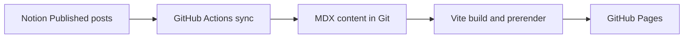

<div align="center">

# simpyll.

**Where healthcare meets code.**

A personal website, development portfolio, and public learning journal exploring software engineering, artificial intelligence, and healthcare technology.

[**Visit simpyll.com**](https://simpyll.com) · [**Read the blog**](https://simpyll.com/blog/) · [**Explore issues**](https://github.com/simpyll/simpyll/issues)

   

</div>

## About

Simpyll is where I document what I'm learning, share what I'm building, and experiment with software that might make healthcare better. The project combines a fast, statically published website with a blog and an evolving portfolio of practical experiments.

## Highlights

- **Modern frontend:** React, TypeScript, Tailwind CSS and Motion.
- **Writing with MDX:** Blog articles live in `src/content/blog`.
- **Notion publishing workflow:** A GitHub Actions integration synchronizes published Notion articles into the repository. See [setup and verification status](docs/NOTION.md).
- **Static prerendering:** Route-specific HTML and metadata for search engines and fast initial loads.
- **Automated deployment:** GitHub Actions builds, validates and deploys to GitHub Pages.
- **Accessible foundations:** Reduced-motion support, keyboard focus styling and skip navigation.

> [!NOTE]
> Features in the [roadmap](docs/ROADMAP.md) are planned, not necessarily implemented. The repository's current code and CI runs are the source of truth for release status.

## Technology

| Area | Stack |
| --- | --- |
| UI | React 19, TypeScript, Tailwind CSS |
| Build | Vite 8 |
| Routing | React Router 6 |
| Animation | Motion |
| Writing | MDX, Notion publishing integration |
| Hosting | GitHub Pages + GitHub Actions |

## How publishing works



The site also supports manually authored MDX posts. Publishing from Notion requires repository configuration and successful workflow runs; see [the detailed guide](docs/NOTION.md).

## Run locally

**Prerequisites:** Node.js 24 and npm.

```bash
git clone https://github.com/simpyll/simpyll.git
cd simpyll
npm ci
npm run dev
```

Open the local URL printed by Vite (normally `http://localhost:5173`).

| Command | Purpose |
| --- | --- |
| `npm run dev` | Start the development server |
| `npm run build` | Type-check, build, generate sitemap and prerender |
| `npm run preview` | Preview production output |
| `npm run lint` | Run lint checks |
| `npm test` | Build, run all Node tests and desktop/mobile browser tests |
| `npm run test:e2e` | Build and run Playwright against production preview |
| `npm run test:e2e:built` | Run Playwright against an already-built `dist` |
| `npm run test:e2e:report` | Open the last browser test report |
| `node --test scripts/prerender.test.mjs` | Check generated routes and SEO |

## Project layout

```text
src/                React app and components
src/content/blog/   MDX articles
src/config/site.ts  Site configuration
scripts/            Build, prerender and publishing utilities
.github/workflows/  CI, deployment and publishing workflows
public/             Public static assets
```

## Roadmap and contributions

Simpyll is evolving. Browse the [feature roadmap](docs/ROADMAP.md) and [open GitHub issues](https://github.com/simpyll/simpyll/issues). Contributions, bug reports and ideas are welcome; start with [CONTRIBUTING.md](CONTRIBUTING.md).

## Documentation

- [Architecture, prerendering and hydration](docs/ARCHITECTURE.md)
- [Deployment and GitHub Pages](docs/DEPLOYMENT.md)
- [Notion publishing and troubleshooting](docs/NOTION.md)
- [Roadmap](docs/ROADMAP.md)

---

<div align="center"><sub>Built to learn, experiment, and share.</sub></div>

See the [design system](docs/DESIGN-SYSTEM.md) for tokens, component conventions, and examples.
